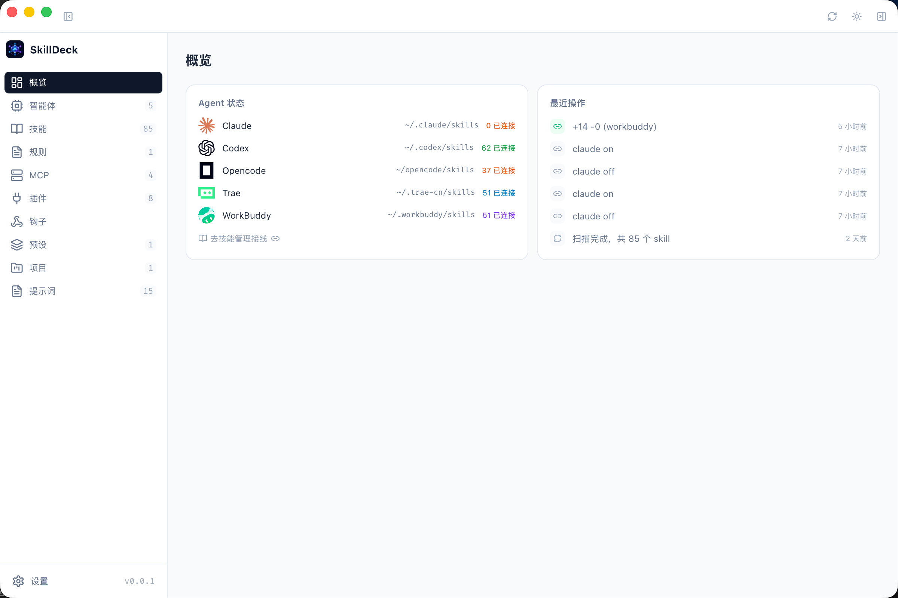
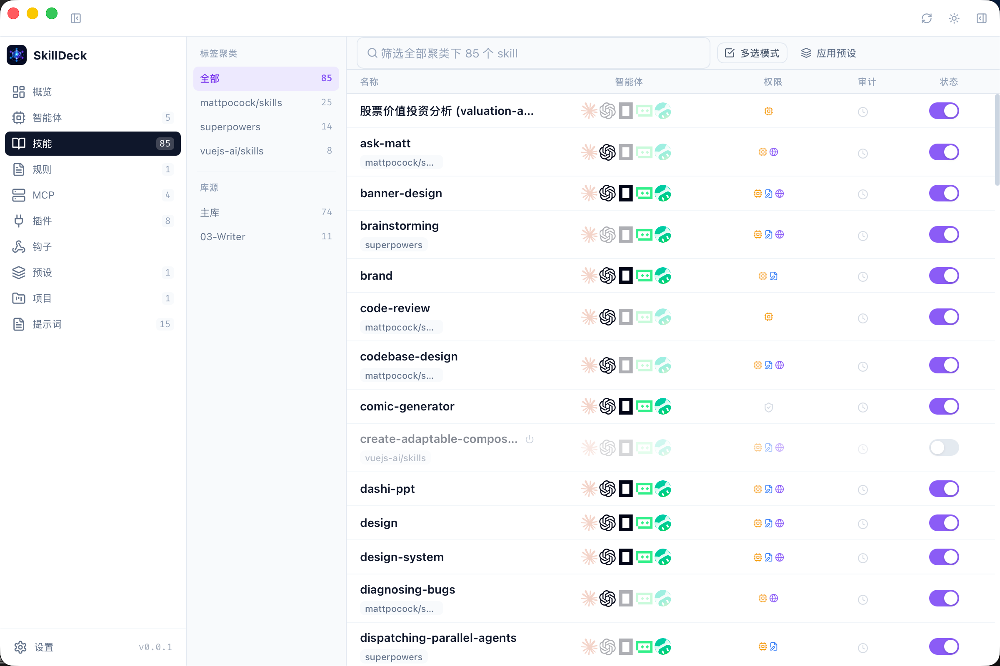
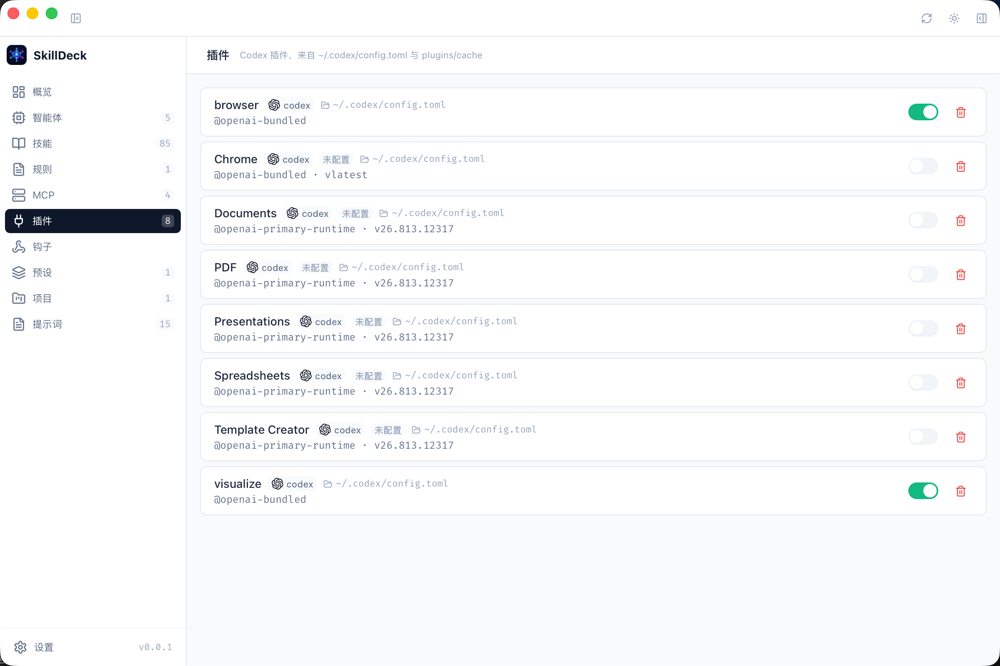
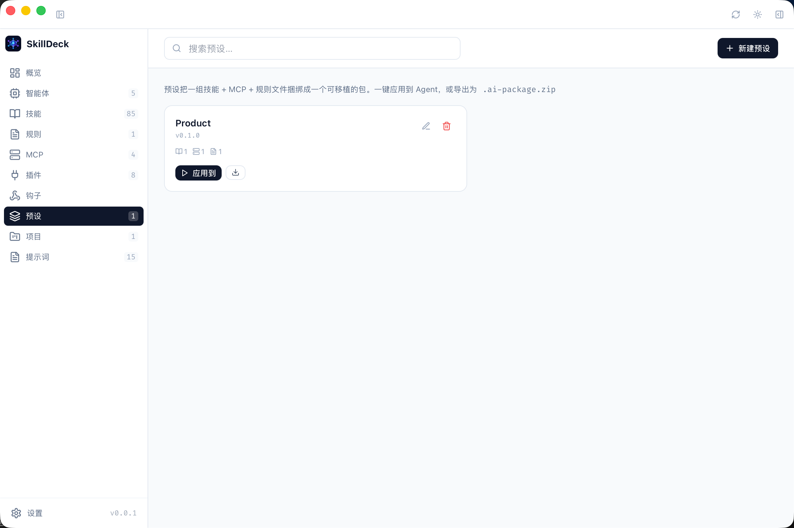

# SkillDeck

SkillDeck 是一个本地 AI Skill 管理器，用来集中管理 Skills、Prompts、Rules、MCP、Plugins、Hooks 和工具集，并按需接入 Claude、Codex、Trae、WorkBuddy 等 Agent。

它的核心目标不是把所有能力一直挂载到每个 Agent，而是维护一个可筛选、可编辑、可接线的本地能力库：需要哪些能力，就接入哪些能力；场景变了，就切换对应组合。

## 预览









## 功能

- **Skill 库源管理**：登记多个本地库源，扫描 `SKILL.md`，查看描述、标签、权限和内容。
- **Skill 安装与更新**：从 Git 仓库、Zip 压缩包或本地目录安装 Skill 到指定库源；记录安装来源与版本，支持检查更新、本地改动检测和事务性替换回滚。
- **Skill 安全审查**：安装与更新前自动执行静态安全审查（凭据读取、破坏性命令、提示注入、可执行二进制、symlink 逃逸等），阻断级问题默认拦截，可显式确认放行。
- **Agent 接线**：为 Skill 创建或断开到各 Agent skills 目录的链接，支持单选和批量操作。
- **冲突识别**：区分软链接、真实目录和真实文件，避免误删或覆盖已有入口。
- **场景预设**：按场景维护 Skill 组合，一键切换当前 Agent 的能力挂载。
- **能力资产管理**：管理 Prompts、Rules、MCP、Plugins、Hooks 和项目工具集。
- **Agent 观察与任务进度**：一键为 Claude Code / Codex 安装观察 Hook，实时查看工具活动、当前任务、当前步骤和进度。
- **本地数据**：数据和 SQLite 数据库保存在本机，不依赖云端服务。

## 技术栈

- 桌面壳：Tauri 2
- 前端：React、TypeScript、Vite、Tailwind CSS、Zustand
- 后端逻辑：Rust、rusqlite

## 开发

要求：

- Node.js 20+
- npm 10+
- Rust stable
- Tauri 2 的平台依赖

常用命令：

```bash
npm ci
npm run dev          # 启动前端开发服务
npm run tauri:dev    # 启动桌面应用开发模式
npm test             # 运行前端单元测试
npm run test:layout  # 运行布局与 Tauri 窗口契约检查
npm run build        # TypeScript 检查并构建前端
npm run tauri:build  # 构建桌面安装包
```

Rust 侧检查：

```bash
cd src-tauri
cargo check --locked
cargo test --locked
```

## 数据位置

macOS 数据目录：

```text
~/Library/Application Support/skilldeck
```

主要文件：

- `skilldeck.db`：SQLite 数据库
- `agent-events.jsonl`：Agent 观察 Hook 的事件日志（最多在界面中展示最近 500 条）
- `~/.skill-deck`：全新安装的默认主库源，会递归扫描库源下的 Skills

## Agent 观察与任务进度

1. 进入「Hooks」页面，在「Agent 观察」中为 Claude Code 或 Codex 打开开关。
2. 重启对应 Agent；Hook 会把会话、工具调用、当前项目与任务进度写入本地事件日志。
3. 回到「概览」页面查看实时 Agent 活动与任务进度；任务进度、步骤或 Agent 状态变化会以客户端右下角 Toast 通知提醒。

观察 Hook 是 fail-open 的纯观察者：Claude 写入 `~/.claude/settings.json`，Codex 写入 `~/.codex/hooks.json` 并启用 `features.hooks`；移除时只删除带 SkillDeck 标记的自有 Hook，不影响其他配置。

任务进度不绑定特定工作流。Hook 事件可以直接携带嵌套 `task` 对象，也可以使用同名字段：

```json
{
  "session_id": "agent-session",
  "cwd": "/path/to/project",
  "hook_event_name": "PostToolUse",
  "task": {
    "id": "login-feature",
    "title": "登录功能",
    "status": "in_progress",
    "progress": 65,
    "step": "修复登录回调"
  },
  "tool_name": "Bash",
  "tool_input": { "command": "npm test" }
}
```

`progress` 支持 `0-1` 比例或 `0-100` 百分比。未上报进度时仍会显示任务、状态、步骤和最近活动，进度显示为 `--`。

已有 `ai-hub` 数据库会在首次启动 SkillDeck 时复制到新的数据目录，原文件保留不删。

## 发布

Release 由 GitHub Actions 自动构建：

1. 在 [`CHANGELOG.md`](./CHANGELOG.md) 的 `Unreleased` 小节填写本次用户可见变化。
2. 运行 `npm run release:prepare -- 0.0.3`，同步前端、Tauri 和 Cargo 版本，并把 changelog 转成带日期的正式版本小节。
3. 检查 diff 并运行发布前检查，然后运行 `npm run release:verify -- 0.0.3`。
4. 提交并推送代码到 `main`。
5. 创建版本标签并推送，例如 `v0.0.3`。
6. `v*` 标签触发 `.github/workflows/release.yml`。
7. Actions 校验 tag 对应的版本和 changelog，使用该版本 changelog 作为 Release Notes，构建 macOS universal DMG 和 Windows x64 安装包并发布到 GitHub Releases。

```bash
git tag v0.0.3
git push origin v0.0.3
```

## 项目结构

```text
src/               React 界面与前端状态
src-tauri/         Rust 命令、扫描器、数据库与桌面壳
scripts/           本地测试脚本
tests/             前端单元测试
```

## 仓库

GitHub：<https://github.com/tingke/skill-deck>
